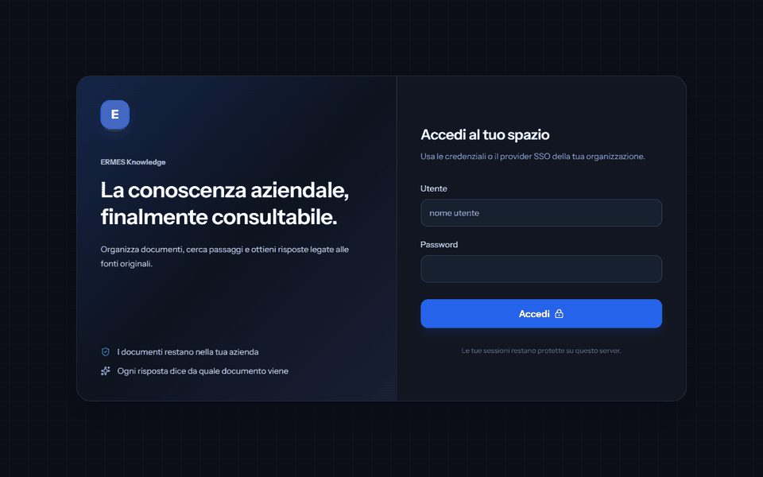
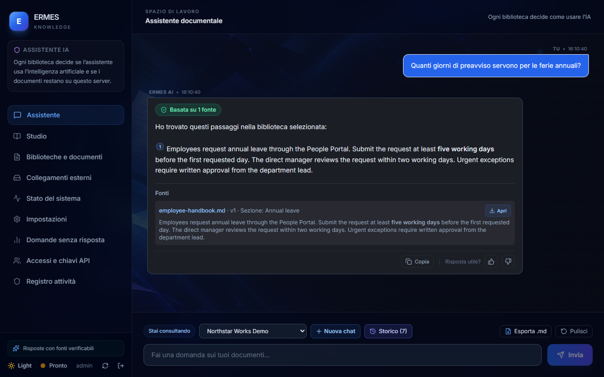
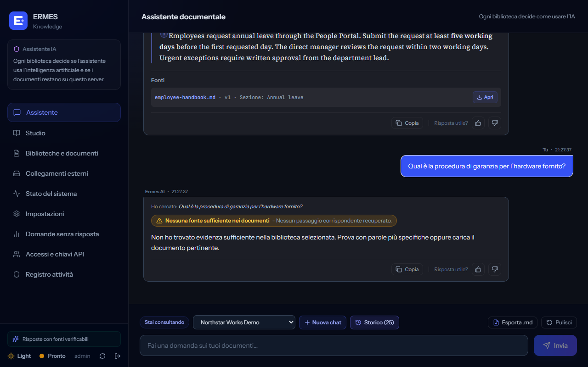
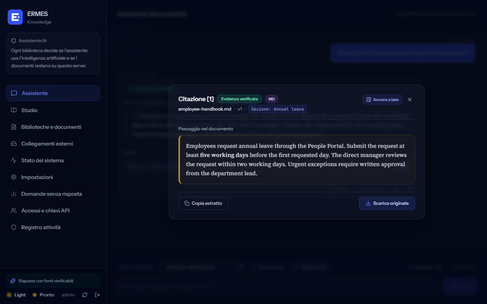
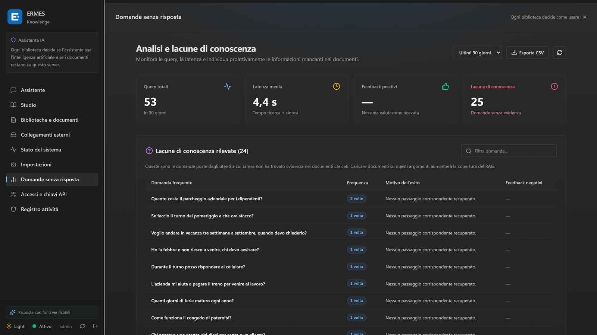
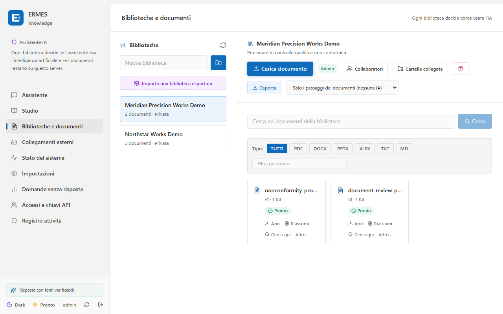
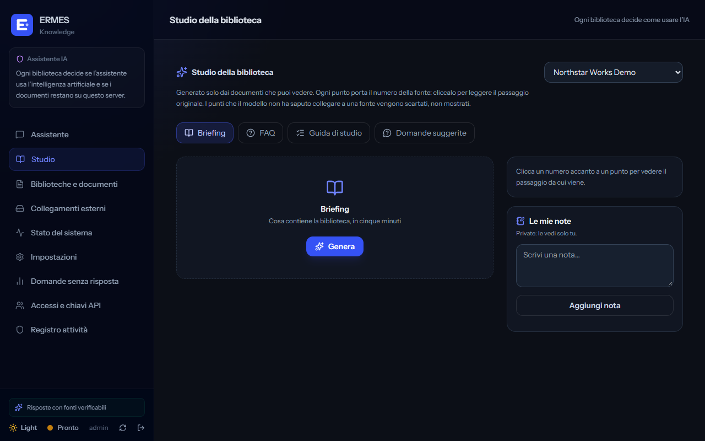
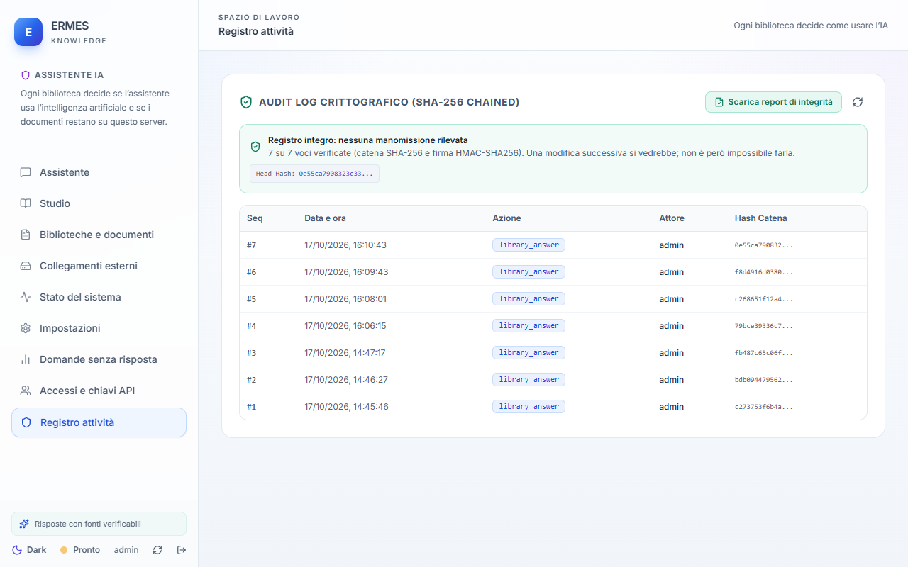
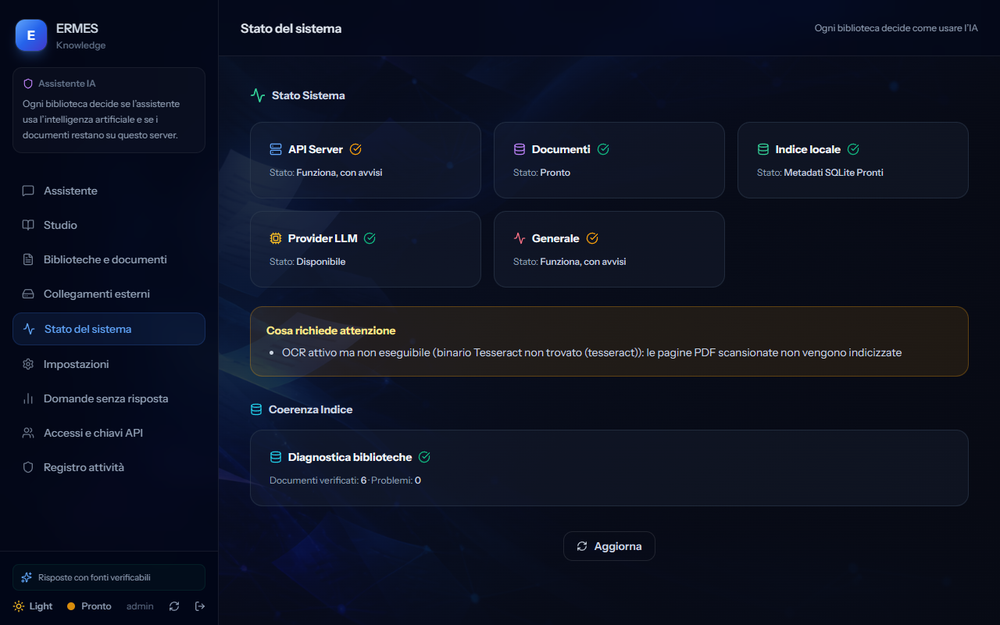
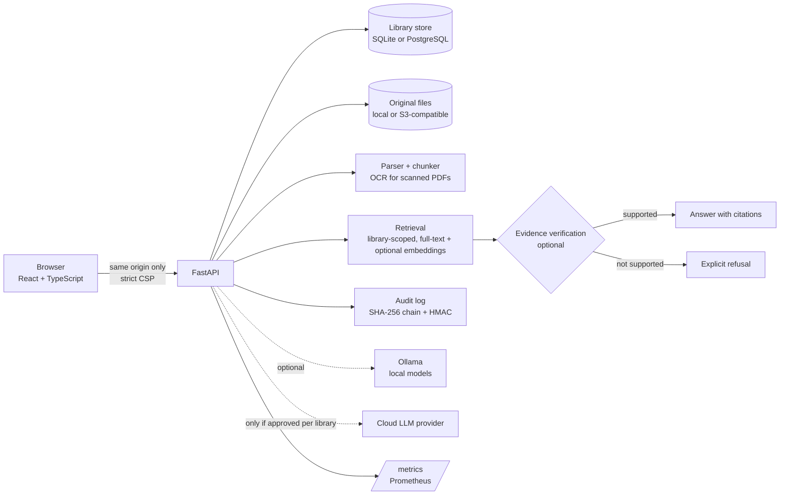

<div align="center">


# Ermes Knowledge

### Ask your company's documents. Get answers that cite the source — or an honest "I don't know".

[](LICENSE)
[](https://github.com/Fioru12/Ermes-Librarian/actions/workflows/ci.yml)
[](https://www.python.org/)
[](https://fastapi.tiangolo.com/)
[](https://react.dev/)
[](docker-compose.yml)
[](frontend/e2e/accessibility.spec.ts)

<p align="center">
  <a href="#quick-start-windows"><b>Quick start</b></a> ·
  <a href="docs/FEATURES.md"><b>Features</b></a> ·
  <a href="docs/BENCHMARKS.md"><b>Benchmarks</b></a> ·
  <a href="#how-it-compares"><b>Comparison</b></a> ·
  <a href="docs/INTEGRATION_GUIDE.md"><b>API & integrations</b></a> ·
  <a href="#documentation"><b>Docs</b></a> ·
  <a href="docs/DESCRIZIONE_PROGETTO.md"><b>Italiano</b></a>
</p>



</div>

---

Ermes Knowledge is a **local-first document library with a question-answering layer**. Upload PDFs, Word, Excel,
PowerPoint, text and Markdown files; ask in plain language; every answer names the file, version, section and exact
passage it relied on. When the documents do not support an answer, Ermes **says so** instead of inventing one.

|  |  |
|---|---|
| **Evidence first** | Every answer cites an accessible source or abstains. With evidence verification on, correct refusals are **16/16** on the project's own test set, at both corpus sizes — [measured, not claimed](docs/BENCHMARKS.md). |
| **Private by construction** | Runs on your server. No telemetry, no fonts or scripts from other domains: a browser test finds **zero external requests** on every screen, and a strict Content-Security-Policy enforces it. A cloud model is used only if an administrator turns it on for a library. |
| **Built for teams** | Per-library isolation and roles, OIDC/SSO, SCIM provisioning, a hash-chained audit log, GDPR export and erasure, an MCP server for AI agents, webhooks for n8n/Zapier/Slack/Teams/Telegram. |
| **Held to a standard** | 860+ automated tests, 248 API operations with a unique, typed OpenAPI contract, **0 accessibility violations** (axe, WCAG 2.1 AA, every screen, light and dark — checked in CI), gitleaks, mypy, ≥75% coverage. |

> **Where is the vector search?** Off by default, on purpose. On the project's golden set, semantic search doubles
> paraphrase recall *and* destroys abstention (1.000 → 0.000); the neural reranker made every configuration worse.
> Both are one flag away (`ERMES_LIBRARY_SEMANTIC_SEARCH=1`, `ERMES_RERANKER_ENABLED=1`); the mechanism that keeps
> abstention at scale is evidence verification, enabled by the [verified profile](#verified-profile-ollama-required).
> The numbers, the embedding-model comparison and the rejected fixes are in [docs/BENCHMARKS.md](docs/BENCHMARKS.md).

## A look inside

<table>
<tr>
<td width="50%"><br/><sub><b>Answers that show their source</b> — file, version, section, exact excerpt, one click to the original.</sub></td>
<td width="50%"><br/><sub><b>Honest refusal</b> — no passage supports it, so Ermes says so and suggests what to do.</sub></td>
</tr>
<tr>
<td><br/><sub><b>Citation inspector</b> — the supporting passage, copy or download the original.</sub></td>
<td><br/><sub><b>Knowledge gaps</b> — the questions nobody could answer show you which documents are missing.</sub></td>
</tr>
<tr>
<td><br/><sub><b>Libraries</b> — separate boundaries, each with its own collaborators and assistant policy. Light theme shown.</sub></td>
<td><br/><sub><b>Studio</b> — briefing, FAQ, study guide and suggested questions, every point tied to a source.</sub></td>
</tr>
<tr>
<td><br/><sub><b>Audit log</b> — every entry is hash-chained and signed; the interface verifies the chain and reports tampering.</sub></td>
<td><br/><sub><b>System status</b> — says what needs attention and why, not just a colour.</sub></td>
</tr>
</table>

## How it compares

Ermes is a small project and does not try to be everything. This table is built from each project's own README as of
October 2026; check them for the current state. It states where Ermes is different **and where it is not**.

| | **Ermes** | Open WebUI | AnythingLLM | Onyx | OpenJarvis |
|---|---|---|---|---|---|
| Main idea | Governed document library with cited or refused answers | General chat UI with built-in RAG | Document workspaces + agents | Enterprise search over many sources | Local-first personal AI agents |
| Published, reproducible abstention measurement | **Yes** ([how](docs/BENCHMARKS.md)) | Not in README | Not in README | Not in README | Not its focus |
| Source citations in answers | Yes: file, version, section, excerpt | Yes | Yes | Yes | n/a |
| Per-library access control, SSO, SCIM | Yes | Roles, OIDC | Multi-user (Docker) | Yes, SSO + SCIM | n/a |
| Tamper-evident audit log | Yes (hash chain + HMAC) | — | — | Enterprise features | — |
| Data connectors | 3 (network folders, web, Microsoft 365) | Via integrations | Many | **50+** | — |
| Agents / deep research | **No** | Yes | Yes | **Yes** | **Yes (8 built in)** |
| Native desktop app | **Partly**: opens in its own window and installs as an app (Edge/Chrome); no native installer | No | **Yes** | **Yes** | **Yes** |
| Interface language | Italian | Many | Many | Many | English |
| Community size | Small | **Very large** | **Large** | **Large** | Growing |

Pick Ermes if you need to *prove* what an answer rests on and what the system refuses to answer, with per-library
control and an audit trail, on your own hardware. Pick one of the others if you need broad connectors, agents or a
large ecosystem today.

## Architecture



Principles: **local first** (a cloud key alone never enables cloud processing) · **evidence before generation** ·
**library isolation inside retrieval** (not as an after-filter) · **documents are untrusted data** (retrieved text can
never authorise an action) · **versions matter** (a citation stays linked to the version that supported it). Decisions
and their trade-offs are in [docs/adr/](docs/adr/); what is defended and what is not is in
[docs/THREAT_MODEL.md](docs/THREAT_MODEL.md).

### What leaves your machine

Nothing, by default. Ermes has no telemetry and the interface loads no third-party fonts, scripts or images (the document typeface
is bundled; a Content-Security-Policy forbids other origins). The connections that exist are the ones you configure:
your Ollama host, an identity provider for SSO, the data sources you connect, and — only when an administrator
explicitly approves a provider for a library — that cloud model.

## Quick start (Windows)

Prerequisites: Python 3.11+, Node.js 18+ and npm. Ollama is optional unless you select `local_ollama` or local semantic search. [Tesseract](https://github.com/tesseract-ocr/tesseract) (with the `ita` data) is needed for scanned PDFs: the Docker image includes it; without it the application starts, `/health` reports the degradation, and pages with no text layer are skipped rather than indexed empty.

```powershell
Copy-Item .env.example .env
py -3.11 -m venv .venv-ermes
.\.venv-ermes\Scripts\Activate.ps1
pip install -r requirements.txt
npm.cmd --prefix frontend install
.\.venv-ermes\Scripts\python.exe scripts\provision_local_demo_auth.py --write
.\scripts\avvia_ermes.ps1
```

> **Avvio rapido con un click (Desktop)**: esegui `CREA_COLLEGAMENTO_DESKTOP.bat`: crea sul Desktop un'icona di Ermes che avvia tutti i componenti e apre l'interfaccia in una finestra propria (Edge o Chrome in modalita' app), senza finestre di terminale. In alternativa, `.\scriptsuild_exe.ps1` compila un lanciatore `Ermes.exe` dai sorgenti in `scripts/launcher/` (il binario non e' nel repository: lo compili tu e sai cosa esegui).

Open [http://127.0.0.1:3000](http://127.0.0.1:3000) (dev) or [http://127.0.0.1:8502](http://127.0.0.1:8502) (standalone). The API health endpoint is [http://127.0.0.1:8502/health](http://127.0.0.1:8502/health).

To check a configuration before starting anything — useful when deploying
somewhere new, or in a CI gate:

```powershell
.\.venv-ermes\Scripts\python.exe -m config.validation
```

It prints each problem with the variable to set and what to do about it, and
exits non-zero if any of them would make the application unusable. The same
check runs at startup: a configuration that cannot serve requests stops the
application rather than turning into scattered runtime errors. That mattered in
practice — with SSO enabled but no issuer or JWKS the application used to start
happily and answer `200` on `/health` while every single login was already
guaranteed to fail.

The project desktop shortcut, if created with `scripts/CREA_COLLEGAMENTO_DESKTOP.ps1`, launches the same official script.
The provisioning command is opt-in and writes first-run credentials only to untracked `.env` and `LOCAL_LOGIN.txt` files.

### Run checks

```powershell
.\.venv-ermes\Scripts\python.exe -m pytest -q tests/
npm.cmd --prefix frontend test -- --run
npm.cmd --prefix frontend run build
```

End-to-end tests run against a **running** instance and exercise the real API,
store and retrieval path — they are what caught unit tests that passed without
verifying anything (see [docs/CODE_REVIEW.md](docs/CODE_REVIEW.md), finding 17).
Start the stack, load the demo corpora, then:

```powershell
.\.venv-ermes\Scripts\python.exe scripts\run_demo_validation.py
npm.cmd --prefix frontend run e2e
```

They read the administrator credentials from `ERMES_ADMIN_USERNAME` and
`ERMES_ADMIN_PASSWORD`, and skip themselves if no password is set.

## Docker

```bash
docker compose up --build
```

This is the shipped default: evidence-only, lexical retrieval, no model in the answer path. CI runs exactly this on a clean Linux clone (`compose-smoke` in [.github/workflows/ci.yml](.github/workflows/ci.yml)): it builds the image, starts the container without Ollama, waits for `/health` to report `healthy`, then runs [scripts/run_demo_validation.py](scripts/run_demo_validation.py) against it — five documents indexed, four cited answers, one abstention, one cross-library isolation check.

### Verified profile (Ollama required)

The default's abstention degrades as a library grows (see above). The fix that was measured to work, evidence verification, needs a model — so this profile declares one as a requirement rather than an option, pulls it on first start, and does not start the app until it is there:

```bash
docker compose -f docker-compose.yml -f docker-compose.verified.yml up --build
```

The first start downloads about 3 GB (`qwen3.5:4b` and `embeddinggemma`); a small model is enough, the 4B and 9B variants scored identically on the golden set. On CPU expect several seconds per question. See [docker-compose.verified.yml](docker-compose.verified.yml) for what it changes.

Runtime documents and the SQLite library database are mounted in `storage/` and are intentionally ignored by Git. The container runs as a non-root user (UID 10001); on native Linux, Docker creates a bind-mounted host directory that doesn't exist yet as `root`, which that user then can't write into — `/health` stays `degraded` forever. Create and own the mounted directories before the first `up` on Linux (Docker Desktop on macOS/Windows doesn't need this — its VM handles the translation):

> **Same folders as the local launcher.** The container mounts `data/`, `storage/` and `security/` from this directory: the same database and accounts the desktop shortcut uses. Never run both at once (they share port 8502 and the same SQLite file; on Windows concurrent access through a Docker bind mount produced `disk I/O error`), and remember that the container sets the admin password from `ERMES_ADMIN_PASSWORD` at every start. For a separate demo or test instance, point the mounts at another folder.

```bash
mkdir -p documenti chroma_db data storage/libraries logs security backups
sudo chown -R 10001:10001 documenti chroma_db data storage logs security backups
```

For a corporate TLS-inspection network, pass the internal root certificate as a Docker BuildKit secret rather than copying it into the image:

```bash
docker build --secret id=corporate_ca,src=company-ca.crt -t ermes-knowledge .
```

## Cloud AI policy

Cloud AI is optional. Before enabling it, set `ERMES_LIBRARY_CLOUD_CONSENT=1` in the local environment and configure a provider through the admin interface using a secret manager or untracked `.env`. A library owner explicitly selects either the dedicated OpenRouter setup or one enabled approved provider; Ermes sends only the retrieved, authorized excerpts to that exact provider. There is no automatic local-to-cloud or provider-to-provider fallback.

Never commit `.env`, document uploads, storage data, API keys or customer content. Rotate any key that may have been exposed in terminal history or source control.

## Demo corpus

Two fictional demo libraries, safe to upload and screenshot: [Northstar Works](examples/demo-corpus/README.md) (HR/IT/expense policies) and [Meridian Precision Works](examples/demo-corpus-quality/README.md) (manufacturing quality procedures). Loading both and asking a question that only the *other* library can answer is the fastest way to show that retrieval never crosses a library boundary — it is not just a design principle, the demo validation script checks it.

For a short presentation sequence, use the [five-minute demo guide](docs/DEMO_GUIDE.md).

With the local application running and an administrator password or API key configured only in `.env`, validate the complete demo flow:

```powershell
.\.venv-ermes\Scripts\python.exe scripts\run_demo_validation.py
```

## Roadmap & Milestones

- ✅ **Core Isolation & Gold Set Evaluation**: Safe two-library demo corpus with live-verified boundary check, measured and published retrieval metrics ([docs/RETRIEVAL_EVALUATION.md](docs/RETRIEVAL_EVALUATION.md)).
- ✅ **OIDC / Enterprise SSO**: Group-to-library ACL propagation (Microsoft Entra ID, Keycloak, Google Workspace).
- ✅ **Connectors & Folder Watcher**: Automated sync daemon for local network folders (SMB/NAS), Web Scraper, and Microsoft Graph / SharePoint.
- ✅ **Dual Database Architecture**: SQLite default for zero-config deployments, PostgreSQL + pgvector for high-scale multi-user nodes.
- ✅ **Enterprise Glossary & Acronyms**: Real-time synonym expansion (`/api/synonyms`) with atomic concurrency locks.
- ✅ **Real-time SSE Streaming**: Direct token-by-token streaming on `/api/libraries/{id}/ask/stream` with live UI feedback.
- ✅ **UI & Governance Polish**: Tamper-evident SHA-256 audit log, Markdown chat export, instant chat reset, and citation modal.
- ✅ **Native Desktop Launcher**: Single-instance Windows launcher (`Ermes.exe`, built from source with `scripts/build_exe.ps1`; no binary is committed) with silent background service management and system tray integration.
- 📋 **2026 Strategic Evolution & Benchmark**: Detailed competitive analysis vs RAGFlow, AnythingLLM, NotebookLM, and strategic roadmap ([docs/PIANO_EVOLUZIONE_E_BENCHMARK.md](docs/PIANO_EVOLUZIONE_E_BENCHMARK.md)).

The historical WinSarp formula engine, kept frozen under `legacy_winsarp/` behind a dev-only flag since August 2026, was removed from the repository on 18 September 2026: its flag path imported routers that no longer existed, so it could not have been switched on. Git history keeps it. `tests/test_legacy_packages_stay_out.py` still fails the build if LlamaIndex, ChromaDB or the Ollama client come back into the product requirements — the reason they were removed in the first place (150 packages instead of 56) has not changed.

## License

GPL-3.0 — see [LICENSE](LICENSE) and [NOTICE](NOTICE). Almost every dependency is
permissive (MIT, BSD, Apache-2.0, ISC). The exceptions are named rather than
averaged away: `psycopg` is LGPL-3.0, and it is the optional PostgreSQL driver —
the product runs on SQLite without it, so an organisation whose policy forbids
(L)GPL can drop that one line from `requirements.txt`. On the JavaScript side
MPL-2.0 (`lightningcss`) and CC-BY-4.0 (`caniuse-lite`) appear in build tooling
only and are not shipped in the bundle. The full inventory with versions is in
[THIRD_PARTY_NOTICES.md](THIRD_PARTY_NOTICES.md), generated by
`scripts/generate_third_party_notices.py` and guarded by
`tests/test_third_party_notices.py` — which is how four missing entries and that
false "every dependency is permissive" claim were found.

## Community and security

- [Contributing guide](CONTRIBUTING.md) and [developer notes](DEVELOPER.md) — how to run the stack, tests and linters locally
- [Security policy](SECURITY.md) — how to report a vulnerability privately; please do not open a public issue for one
- [Code of conduct](CODE_OF_CONDUCT.md)
- Every change goes through a pull request with CI: pytest, vitest, lint/mypy, gitleaks secret scan, clean-clone `docker compose` smoke test and a browser E2E against the container. The full Git history was scanned for secrets before the repository went public.

## Documentation

Each document is written for a reader with a job to do. Start with the first three.

- [Features and principles](docs/FEATURES.md) — the complete list of what Ermes does
- [Benchmarks](docs/BENCHMARKS.md) — every number, including the unflattering ones, and how to reproduce it
- [Runbook](docs/RUNBOOK.md) — install, back up, upgrade and diagnose, written for whoever operates it
- [Monitoring](docs/MONITORING.md) — Prometheus metrics, a ready-made Grafana dashboard, alert rules, an optional one-command stack, SIEM forwarding
- [Threat Model](docs/THREAT_MODEL.md) — assets, trust boundaries, what is defended and what is not, with automated CI verification
- [Retrieval Evaluation](docs/RETRIEVAL_EVALUATION.md) — golden set, abstention analysis, the embedding-model comparison, the fixes that were measured and rejected
- [Architecture decisions](docs/adr/) — why evidence-first with a lexical default, why permissions filter inside retrieval, why SQLite and no RAG framework
- [Integration Guide](docs/INTEGRATION_GUIDE.md) (IT) — REST, SSE, n8n/Zapier, Slack/Teams/Telegram, MCP, SCIM, with [client examples](examples/integrations/)
- [One-pager](docs/ONE_PAGER.md) — the short version, for someone evaluating this project in two minutes
- [Demo Guide](docs/DEMO_GUIDE.md) — the walkthrough behind the animation above, step by step
- [Changelog](CHANGELOG.md) — a readable log of this work, not a raw commit list
- [Descrizione del progetto](docs/DESCRIZIONE_PROGETTO.md) (IT) — architecture, RAG flow, security and enterprise modules
- [Guida operativa aziendale](docs/GUIDA_OPERATIVA_AZIENDA.md) (IT) — for the IT team: Docker, Windows, OIDC, backup, NAS
- [Code Review](docs/CODE_REVIEW.md) and [Audit 2026-08-19](docs/AUDIT_2026-08-19.md) — the findings that shaped the current code, kept because several comments in the code point at them
- [Postgres Migration Plan](docs/POSTGRES_MIGRATION_PLAN.md) and [Release Plan](docs/GITHUB_RELEASE_PLAN.md) — historical planning documents

Course material (thesis, slides, presentation assets) and superseded internal plans were removed from the public tree on
18 September 2026; Git history keeps them.
