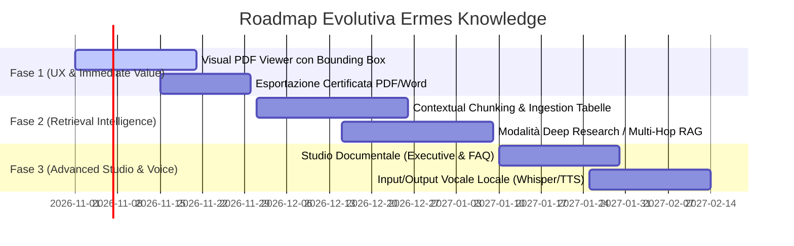

# 🚀 Ermes Knowledge — Benchmark Competitivo e Piano di Evoluzione (2026)

> **Documento:** Analisi di Posizionamento Tecnologico e Roadmap di Innovazione  
> **Versione Progetto:** 2.4.0  
> **Data:** Ottobre 2026  
> **Stato:** Strategico / Architettura  

---

## 1. Executive Assessment dello Stato Attuale (v2.4.0)

Ermes Knowledge si trova in uno stato di **maturità produttiva elevata** (Production-Ready per ambienti On-Premise e Cloud Privato). A differenza di molti progetti RAG open-source che si limitano a essere "wrapper" di librerie generiche, Ermes possiede un'architettura enterprise proprietaria solida e disciplinata:

- **Evidence-First & Zero Allucinazioni:** Meccanismo di astensione rigorosa (`NON_EVIDENCE`) e verificatore neurale delle evidenze (`core/evidence_verifier.py`).
- **Data Sovereignty & Local-First:** Funzionamento 100% offline nativo con Ollama/vLLM; nessuna dipendenza o telemetria cloud forzata.
- **Sicurezza e Governance di Grado Bancario:**
  - Isolamento delle biblioteche verificato prima del context window (Zero Cross-Contamination).
  - Quarantena deterministica preventiva per attacchi di Prompt Injection indiretta nei documenti (`core/injection_guard.py`).
  - Registro di Audit crittografico firmato HMAC-SHA256 per singola voce (`core/audit_chain.py`).
  - Gestione identità RBAC integrata con OIDC/SSO e mappatura automatica dei gruppi ai ruoli di biblioteca.
  - Conformità GDPR nativa (esportazione Art. 15 e cancellazione con oblio Art. 17).
- **Integrazioni e Canali Estesi:** Connettori cartelle NAS/SMB, Microsoft Graph (SharePoint/OneDrive), Confluence, S3, WebDAV, server nativo Model Context Protocol (MCP), webhook per n8n/Zapier e bot per Slack, Teams e Telegram.
- **Esperienza Desktop:** Launcher nativo Windows C# ([`Ermes.exe`](../Ermes.exe)) compatto (~31 KB), single-instance con mutex, system tray e visualizzazione in finestra standalone (App Mode).
- **Affidabilità e Qualità del Codice:** 873 test backend pytest, 112 test frontend Vitest, suite E2E Playwright, migrazione a Tailwind 4 completata (0 vulnerabilità npm) e backend dati duale (SQLite o PostgreSQL + pgvector).

---

## 2. Benchmark con i Top Progetti Open-Source (2025/2026)

L'analisi dell'ecosistema globale di riferimento su GitHub evidenzia i benchmark di settore e i trend dominanti:

| Progetto / Framework | Punti di Forza Riconosciuti | Gap Rispetto a Ermes | Cosa Possiamo Mutuare per Ermes |
|---|---|---|---|
| **RAGFlow** (`infiniflow/ragflow`) | **Deep Document Understanding:** Parsing visuale avanzato di layout complessi, tabelle annidate e note a piè di pagina. | Architettura pesante, requisiti di risorse elevati; governance e permessi meno integrati. | **Table & Layout Parsing:** estrazione di tabelle complesse in formato Markdown strutturato preservando intestazioni di colonna. |
| **AnythingLLM** (`Mintplex-Labs/anythingllm`) | Installazione desktop "one-click", UI moderna, gestione intuitiva delle cartelle e dei modelli locali. | Controllo accessi e verifica anti-allucinazione meno rigorosi; audit log basilare. | **Visual Document Preview:** drawer laterale interattivo per sfogliare i documenti sorgente. |
| **Open WebUI** (`open-webui/open-webui`) | Interfaccia in stile ChatGPT, personalizzazione prompt, community enorme. | Orientato al modello generalista, debole su isolamento formale delle fonti aziendali e conformità GDPR. | Fluidità dell'interfaccia conversazionale e controlli di generazione dinamici. |
| **Anthropic Contextual Retrieval** | **Contextual Chunking:** arricchimento dei chunk di testo con un breve prefisso contestuale dell'intero documento prima dell'embedding. | Tecnica di ricerca (non un'applicazione completa). | **Eliminazione dell'amnesia dei chunk:** riduzione stimata del 35-49% dei fallimenti di retrieval per frasi che non contengono il soggetto esplicito. |
| **LightRAG / GraphRAG** | **Graph-Augmented Retrieval:** estrazione di entità e relazioni per collegare fatti distribuiti su file diversi. | Costoso computazionalmente per corpora ampi; latenza di indicizzazione elevata. | **Knowledge Graph opzionale:** utile per interrogazioni relazionali (es. mappa fornitori-normative-contratti). |
| **Google NotebookLM** | **Studio & Sintesi:** trasformazione rapida dei file in guide, FAQ, briefing e audio overview (podcast). | Piattaforma proprietaria cloud Google; non utilizzabile per dati riservati on-premise. | **Potenziamento del tab Studio:** generazione "one-click" di executive briefing e domande di onboarding da intere biblioteche. |

---

## 3. Matrice dei Differenziatori di Ermes (Il nostro "Moat")

Ermes Knowledge possiede caratteristiche uniche che i software concorrenti generalisti raramente implementano:

```
┌─────────────────────────────────────────────────────────────────────────────┐
│                        ERMES ENTERPRISE ADVANTAGES                          │
├────────────────────────────────┬────────────────────────────────────────────┤
│ 1. Isolamento Matematico       │ Il contesto non entra MAI nel prompt prima │
│    delle Biblioteche           │ del filtro ACL della specifica biblioteca.  │
├────────────────────────────────┼────────────────────────────────────────────┤
│ 2. Evidenza Obbligatoria       │ Nessuna risposta inventata: o c'è la fonte │
│    (Anti-Allucinazione)        │ verificata, o dichiara NON_EVIDENCE.       │
├────────────────────────────────┼────────────────────────────────────────────┤
│ 3. Difesa Iniezione Documenti  │ Il testo nei file è trattato come input    │
│    (Untrusted Data Layer)      │ ostile e bonificato prima del modello.     │
├────────────────────────────────┼────────────────────────────────────────────┤
│ 4. Audit Trail HMAC-SHA256     │ Immutabilità e rilevamento manomissione    │
│    per Singolo Evento          │ su ogni operazione e risposta generata.    │
├────────────────────────────────┼────────────────────────────────────────────┤
│ 5. Desktop Standalone Nativo   │ Zero finestre di terminale nere, 30 KB     │
│    su Windows                  │ launcher C# con avvio trasparente servizi. │
└────────────────────────────────┴────────────────────────────────────────────┘
```

---

## 4. Piano di Innovazione e Roadmap Dettagliata

Sulla base del benchmark, sono state identificate 6 iniziative strategiche per estendere il valore del prodotto.

### Iniziativa 1: Visual Document Viewer & Evidenziazione Fonte (UX "Effetto Wow")
- **Problema:** Attualmente l'utente vede la citazione come testo estratto `[1] procedura.pdf — pag. 14`.
- **Soluzione:**
  - Integrare un visualizzatore PDF compatto (es. PDF.js) in un drawer/modal a comparsa.
  - Al clic su `[1]`, il drawer apre istantaneamente il documento originale a **pagina 14** con la frase o la sezione evidenziata in giallo.
  - **Impatto:** Fornisce una prova visiva immediata e rassicurante per revisori, legali e personale non tecnico.

### Iniziativa 2: Deep Research & Query Decomposition (Agentic Multi-Hop RAG)
- **Problema:** Se l'utente pone domande comparative (es. *"Quali differenze ci sono tra il contratto di locazione del 2024 e quello del 2025?"*), una singola ricerca vettoriale recupera frammenti disomogenei.
- **Soluzione:**
  - Aggiungere una modalità toggle **"Ricerca approfondita"** (Deep Research).
  - Un router analizza la query: se è complessa/comparativa, la scompone in 2-3 sotto-domande mirate eseguite in parallelo.
  - Sintesi comparativa strutturata (es. tabella Markdown con colonne "Aspetto", "2024", "2025", "Citazioni").

### Iniziativa 3: Contextual Chunking & Ingestion Avanzata Tabelle
- **Problema:** Un paragrafo come *"La penale per ritardo è del 5% su base mensile"* estratto a pagina 20 non contiene il nome del fornitore o il tipo di servizio.
- **Soluzione:**
  - **Contextual Retrieval:** Durante l'ingestion in background, il modello locale genera un breve prefisso contestuale (es. *"Contratto Fornitore Acme 2024 - Clausola 8 Penali:"*) che viene unito al chunk prima di calcolare l'embedding e il full-text.
  - **Preservazione Tabelle PDF/Excel:** Riconoscimento intelligente delle tabelle con conversione in Markdown strutturato, conservando la riga di intestazione associata a ciascuna riga dati.

### Iniziativa 4: Studio Documentale Enterprise (Stile NotebookLM Offline)
- **Problema:** Spesso l'utente non vuole fare una domanda specifica, ma desidera comprendere rapidamente un nuovo fascicolo documentale.
- **Soluzione:**
  - Potenziare la scheda **Studio** (`core/library_studio.py`):
    - **Executive Summary:** Generazione di una sintesi esecutiva in 1 pagina dell'intera biblioteca.
    - **FAQ della Biblioteca:** Estrazione automatica delle 10 domande e risposte più importanti.
    - **Formazione & Onboarding:** Generazione di schede didattiche e quiz a risposta multipla con riferimenti per formare il personale sui regolamenti interni.

### Iniziativa 5: Interazione Vocale Locale (Whisper STT + Piper TTS)
- **Problema:** L'inserimento da tastiera può essere limitante in contesti di produzione, magazzino o mobilità aziendale.
- **Soluzione:**
  - **Speech-to-Text (Input):** Icona microfono per dettatura vocale della query elaborata in locale con Whisper (CPU/GPU-friendly).
  - **Text-to-Speech (Output):** Pulsante "Ascolta risposta" che legge l'estratto con voce naturale (es. tramite Piper TTS, 100% offline e ultra-leggero).

### Iniziativa 6: Esportazione Formattata Certificata (PDF / DOCX Aziendale)
- **Problema:** L'esportazione attuale produce un file Markdown (`.md`), che richiede formattazione manuale prima di essere allegato a pratiche ufficiali.
- **Soluzione:**
  - Generazione di report in formato **PDF/Word con layout istituzionale**:
    - Frontespizio con logo aziendale Ermes, data/ora e utente che ha eseguito l'interrogazione.
    - Testo della risposta con numerazione progressiva delle citazioni.
    - Tabella conclusiva di conformità con elenco dei documenti consultati, relative pagine, data di modifica e digest crittografici SHA-256.

---

## 5. Ordine di Priorità e Fasi di Implementazione Suggerite



1. **Fase 1 (Quick Win ad Alto Impatto Visivo):** Visual PDF Viewer con evidenziazione ed esportazione report aziendali.
2. **Fase 2 (Precisione Algoritmica):** Contextual Retrieval e modalità Deep Research per interrogazioni complesse.
3. **Fase 3 (Esperienza Avanzata):** Moduli Studio completi e supporto vocale locale.
